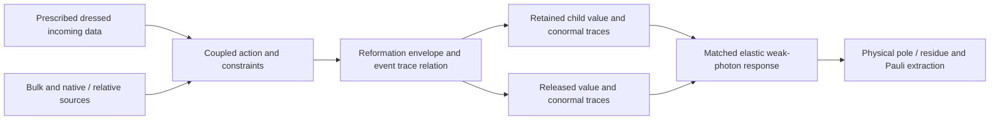

# v83 forced native component and event relation

Scientific excerpt of the local v83 report. The broad recall inventory and access/coordination history are excluded; original source hashes and exact extraction are recorded in provenance.json. The conditional scope is unchanged.

## The map to construct, with newly formed child points

The user's interpretation is parent disturbance, transient reformation
envelope, then a new child boundary and released channels. Inherited physical
content does not imply identity of boundary point labels. Consequently the
mathematical target is a **forced trace relation** on the solved event domain,
not a stipulated full-parent pointwise pullback:

On a regular patch of a *given common constrained* background X, the input
spaces are the weak bulk source dual, the prescribed incoming trace space,
and the affine event-source space. Outputs are retained/released value
traces and their action conormals, paired with independent dual traces. For
the product component used below they are the regular H^(1/2) value and
H^(-1/2) flux spaces of its angular operator. The general causal first-order
system instead uses its owned incoming/Green graph and regular-pole weighted
domain; these two domains are not identified by notation.

The action equations impose the bulk Euler equations, Hamiltonian/momentum/
Gauss constraints, inherited entering conditions, intrinsic and interface
traction, future outgoing released conditions, and their corner compatibility.
Gauge/BRST null directions are quotiented only where the owner proves it.
An event relation can be nonlocal or have unequal retained/released trace
dimensions. A smooth pointwise pullback is a possible regular special case,
not a rule forbidding new child points. Sharp-indicator splitting of a weak
conormal is not used.

## Explicit bulk-source application of the owned native factor

Use precisely the v79 regular product component after its unitary connection
transport and density isometry:

    A = partial_x + W0,       A* = -partial_x + W0,
    L_mu = A* A + mu^2,      0 < x < h,   mu > 0.

`mu` is a resolvent parameter, not a selected mass, cutoff or calibration.
For an angular spectral value w of the self-adjoint W0, set
`k=sqrt(w^2+mu^2)`. Both boundary values q0,qh remain free. For arbitrary bulk
source f on this component, the exact solution is

    u(x) = K0(x) q0 + Kh(x) qh + integral_0^h G_D(x,y) f(y) dy,
    K0(x) = sinh(k(h-x))/sinh(kh),
    Kh(x) = sinh(kx)/sinh(kh),
    G_D(x,y) = sinh(k min(x,y)) sinh(k(h-max(x,y))) / (k sinh(kh)).

The Dirichlet condition belongs only to this auxiliary particular Green
operator. No physical endpoint value is set to zero. The Green kernel has
zero endpoint values, is continuous at x=y and has derivative jump -1,
so `L_mu G_D=delta`. These are independently checked as exact Laurent
polynomial identities, not by choosing example sources.

With native conormals `pi0=-A u(0)`, `pih=A u(h)`, the **explicit forced map** is

    [pi0] = [ k coth(kh)-w   -k csch(kh) ] [q0] + [j0],
    [pih]   [ -k csch(kh)   k coth(kh)+w ] [qh]   [jh],

    j0 = -integral_0^h K0(y) f(y) dy,
    jh = -integral_0^h Kh(y) f(y) dy.                 (1)

The signs follow by differentiating G_D at both outward faces. The w endpoint
contacts act on the homogeneous values; they vanish on the auxiliary
zero-value particular solution and have not been discarded from N.
Equation (1) is an integral operator on **all** admissible f, not an adapter
accepting unspecified j0,jh. It is the new concrete component.

For an independent analytic left boundary row `(a0,ah)`, its bulk-source work
is exactly `-integral (a0 K0(y)+ah Kh(y)) f(y) dy`. At the real product base
the norm proof uses the Hilbert pairing; this does not conjugate independent
analytic source or left-state coefficients.

### Source and moving-domain derivative

At fixed physical y,

    partial_h K0 = k sinh(ky)/sinh(kh)^2,
    partial_h Kh = -k coth(kh) Kh,
    partial_k K0 = (h-y) cosh(k(h-y))/sinh(kh)
                  -h coth(kh) K0,
    partial_k Kh = y cosh(ky)/sinh(kh)-h coth(kh) Kh.

These are checked from the exact kernels. On a fixed pulled interval y=h xi,
write `Ki(y)=ki(a,xi)`, `a=kh`, and `fhat(xi)=f(h xi)` including the actual
source/frame pullback. The complete scalar commuting variation is

    (ji)_Y = - integral_0^1 [h_Y ki fhat
                +h (ki)_a (h k_Y+k h_Y) fhat
                +h ki fhat_Y] dxi.                 (2)

At fixed y the equivalent formula has the Leibniz face term; in particular
the upper term for jh is `-h_Y f(h)`. Equation (2) retains it through the
pullback. A lower moving face, independent left motion and frame/normal
contacts must also be restored from their actual maps.

If W_Y does **not** commute with W0, scalar `k_Y` cannot be used as a matrix
substitute. The operator derivative uses the divided difference of Ki:

    (D Ki(W0)[W_Y])_ab = Ki^[1](w_a,w_b) (W_Y)_ab,

with the derivative limit on equal eigenvalues. This follows by differentiating
spectral functional calculus (or its resolvent), and retains off-diagonal
angular/family mixing. Total mixed variation differentiates every factor and
source map in (1)-(2); the existing nine ordered native placements and single
overlap subtraction remain required. This scalar kernel computation is not
a replacement for those complete mixed native/relative terms.

## A new propagated-source range test

The exact Gram matrix of the two source kernels is

    integral [K0;Kh] [K0,Kh] dy = [[a,b],[b,a]],
    a = coth(kh)/(2k) - h/(2 sinh(kh)^2),
    b = (h cosh(kh)-sinh(kh)/k)/(2 sinh(kh)^2).

All three integrals are checked exactly. Since K0,Kh are nonnegative, b>=0;
Cauchy-Schwarz gives b<=a. Also a<=1/(2k): after simplification this is
`1-exp(-2kh)<=2kh`. Thus the actual source map obeys

    k (|j0|^2+|jh|^2) <= ||f||_L2(0,h)^2.           (3)

Summing spectrally gives the corresponding all-angular weighted bound.
Bulk forcing therefore does not generate arbitrary rough boundary flux.
Nevertheless (3) alone does **not** supply the missing inverse bound.

This can be proved on the owned product operator, without a finite model or
physical occupation. For w>0, its normalized factor-kernel profile is

    phi_w(x) = sqrt(2w/(1-exp(-2wh))) exp(-wx),
    A phi_w=0,    ||phi_w||_L2=1.

In the **auxiliary** homogeneous-native-conormal problem, `f=phi_w` has exact
response `u=phi_w/mu^2`. Its trace satisfies

    |u(0)|^2+|u(h)|^2 = 2w coth(wh)/mu^4.            (4)

This diverges as w grows, despite a unit bulk source and the smoothing in
(3). Negative w gives the reflected endpoint layer. This is a domain/range
test of the product factor, **not an adopted physical Neumann endpoint,
packet, state, instability or muon contribution**. If a particular angular
sector has no unbounded positive spectrum, the stated positive sequence
applies only to a sector that does; the reflected statement covers the
negative sequence. No new spectral branch is selected.

For an actual f the relevant layer moment is

    m_w(f) = integral_0^h conjugate(phi_w(x)) f_w(x) dx.

The trace of this normal spectral component alone has squared H^(1/2)
weight asymptotic to `2 w^2 |m_w|^2/mu^4`. Thus this component requires the
corresponding weighted moment sum, or its action-owned removal/control by
the completed event relation. Other normal components and the full matched
observable may cancel projections; equation (4) is not proof of their
dependence. Raw forcing annihilation and a small finite matrix residual
cannot replace a test of the **propagated** charged source and dual range.
The offline visibility result is consistent with this distinction, but was
not used as continuum evidence or rerun.

## Joining the event without deleting released forcing

If the actual intrinsic/released relation has a graph patch

    pih + L qh + j_tail = 0,

put H=N11+L. Then, only on its admissible invertible range,

    qh = -H^-1(N10 q0+jh+j_tail),
    pi0 = (N00-N01 H^-1 N10)q0+j0-N01 H^-1(jh+j_tail). (5)

Now j0,jh in (5) are the explicit applications (1), rather than omitted
homogeneous-child loads. L and j_tail retain intrinsic inertia, released
channels, native/relative/domain contacts and entering work. When the graph
or inverse fails, the uneliminated relation and constraints remain the map;
no pseudoinverse, artificial endpoint or fitted loss is installed.

For a nonconstant common background, v80's same-domain first-factor form
correction remains necessary. With `T` its bounded form perturbation and
`||T||=epsilon<1`, the inverse-series remainder is bounded by
`epsilon^(m+1)/(1-epsilon)`, multiplied by the **actual** source and dual norms.
These operands have not been evaluated on the physical background here.
Likewise a corrected tail solve needs its own inverse/range bound. Neither
nonconstant correction nor tail load is assigned zero. Native proper/spectral
coordinates are not identified with causal time or the D5 spatial normal.

## Reconciliation with the October Schur and chronological solves

The recovered daughter expression `Gamma_eff=A-Bc D_out^-1 Cc` is valid only
after D_out's outgoing domain and the source applications exist. With
`D u=Cc R`, `D^T p=(L Bc)^T`, its fixed-L/R derivative is exactly

    L A_s R - L (Bc)_s u - p^T (Cc)_s R + p^T D_s u.

The transpose is the independent analytic dual. For nonzero entering/bulk
load, use `z=D^-1(r-Cb)` and returned row `t=A b+Bz+a`. Then

    (L t)_s = L_s t + L(A_s b+A b_s+B_s z+a_s)
                 +p^T(r_s-C_s b-C b_s-D_s z),
    D^T p = B^T L^T.                               (6)

The fully ordered forced derivative (6) is checked in noncommuting algebra.
It includes the returned source which a homogeneous Schur formula alone
omits. Moving left/right, constraints and domain pullbacks stay inside the
owned derivatives. The historical chronological equations
`z0=-G_Z^R rZ`, `zj=-G_Z^R K_ZB ej`, `Cj=T_Z zj+sj` and
`K_ZZ^R z_Y=f_Y-(K_ZZ^R)_Y z` are the causal versions of this operation,
not evidence that it was executed. Their causal K_ZZ cannot be replaced by
the positive product L_mu used to obtain (1).

The October 17 material magnetic endpoint contribution `-[H_b]`, independent
left/rate terms, source/clock/measure/frame motion and the corrected angular
product quadrature remain part of that causal application. The saved
24-point rule must not be reused for its failed degree-six product. None
of these historical campaigns was repeated.

## Exact remaining construction and next step

The first absent *application* is still the closed, forced **first-factor
event trace relation on the common constrained X**, restricted at least to
the actual charged/normal-partner source and independent dual ranges. Its
bulk expressions and local seam jets exist. What is not instantiated is the
joint physical entering comparison/columns and retained/released trace
graph that would make K_ZZ^R, T_Z, their moving-source jets and the native
action adjoint act on one domain. The October 19 source-chain nulls and
provisional-history receipts identify this limit concretely. The mathematical
formula for an inverse, a local pivot, a stationary18 block or the product
kernel cannot supply it.

The smallest useful next construction is to **lift the actual prescribed
stationary-past four-column source and independent dual into that common
first-factor event graph and compute its normal-layer moments** m_w and
released load, with the source derivative. If the full coupled graph is
needed to obtain those moments, its residual must first be executable from
the same action and constraints. No broader solve is launched: the present
record still lacks that complete evaluator. No reliable numerical cost can
be assigned to an undefined physical residual. The bounded symbolic work
here takes under a second per replay and needs no new spatial resolution.

This is unfinished mathematical construction under the existing adopted
preparation and action, not a request for the author to choose a new state or
attachment law. The recovered historical density ambiguity alone does not
prove that new physics is necessary. Nor is complete source cancellation or
physical nonuniqueness proved here. The exact kernel and range test (1)-(4)
are reusable once the physical source application is constructed.

No actual magnetic connectivity change, released-energy allocation, child
state or elastic Pauli anomaly has been computed. The reconnection proposal
must still satisfy the saved flux and energy balances on the solved event,
then enter the matched elastic vertex. Production/reformation is not itself
a_mu. The last admitted temporal20 state remains t=2^-9; the later wall point
is a separate conditional diagnostic. The physical guard remains 2e-10,
method tolerance 2e-11. Physical columns, c_F, full residual, a_mu/g_mu and
complete uncertainty remain open. The older calibrated additive subtotal
is unchanged and incomplete. No commit or push was made.

Reproduce the new checks with `C:\Python314\python.exe -I -S
verify_forced_kernel.py --out <fresh child directory>`. The verifier rejects
unbounded startup paths and imports only stdlib. Its final two runs must be
byte-identical. No archived/repository owner code is imported or executed.
