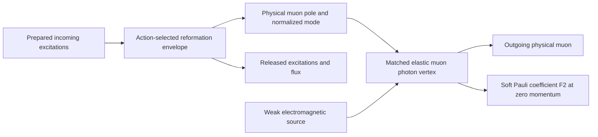

# v64: magnetic reconnection and the muon photon vertex

The retained action supplies a concrete flux-change test, an energy-work
balance, and the ordered weak-photon insertion through the first-order exterior
return. These identities are verified here. They **permit testing** Norman's
proposed reconnection mechanism; they do not establish that the prescribed
collision actually reconnects, what child state results, or its magnetic anomaly.
The missing item is the action-selected physical event/common-domain solution,
not an additional author rule about which boundary points to select.

This checkpoint uses one worker, no new field resolution, history solve, heat
integration, preparation choice or occupation assignment. V63 is unchanged.
Its pointwise pullback is now explicitly scoped to regular transport branches.

## Plain-language worked example

The proposed mechanism is that an interaction disturbs an existing excitation;
an envelope reforms its retained physical content into a muon child while other
excitations escape. New child boundary points need not preserve parent labels.
The action must determine the transfer, flux and released energy. A change of
labels or a changing magnetic field alone does not establish reconnection.

The magnetic-moment calculation subsequently asks how the resulting physical
muon responds to a weak photon. Production and that elastic response are distinct:



The envelope box can require a nonlinear event saddle or transfer kernel.
It is not automatically one ordinary perturbative vertex. A solved regular
branch can induce a pointwise map even though its points are newly formed.
A general event transfer may instead map incoming physical traces into both
child and released channels, with mode mixing and affine sources. Neither a
global parent-child bijection nor a new arbitrary transfer law is assumed.
No claim is made that all physical muon production is direct proton breakup.

## 1. What the original Maxwell action tests

The full retained connection has `F=dA+A wedge A`, with `D F=0`. Its hypercharge
generator is central: the original `_bracket` has identically zero Y component.
Thus the central curvature `F_Y` is closed. For a smooth moving two-surface,
with its actual material evolution vector `u`, Cartan's identity gives

    d/dt integral_S(t) F_Y = integral_boundary(S) i_u F_Y
                          = -integral_boundary(S) E_u,
    E_u = -i_u F_Y.

On an ordinary physical three-dimensional magnetic slice this is the familiar
`E_u = E + v cross B` one-form convention. In the higher-dimensional parent
domain the two-form equation is the definition; no three-dimensional cross
product is imposed on that domain. Flux freezing would require the appropriate
circulations to vanish. It is not an extra equation supplied by the Maxwell
action. No resistivity, dissipation constant or reconnection rule is added.

The existing central constant-angular sector has the exact normalization

    L = kappa/2 [e (a_t-beta a_rho)^2-r a_rho^2-4 d a^2],
    kappa = MAXWELL_TO_CAP = 1/[8 (2 pi^2)^2],
    Pi = kappa e (a_t-beta a_rho),
    Q = -beta Pi-kappa r a_rho,
    Pi_t+Q_rho+4 kappa d a = j_bulk.

For a material radial speed `w`, its evaluated algebraic flux operand is

    F_Y(u,E_i) = Pi_i/(kappa e)+(beta+w) a_i,rho.

This formula is for that retained sector. In the full action it is
`F_ti+w F_rhoi+u^j F_ji`, including `-E_i A_t`, `-w E_i A_rho`, angular
motion and noncentral commutators where applicable. None is erased from the
physical event. The future coordinate clock and actual material motion must
agree; `w` has not been assigned from an unmatched initializer.

At fixed material coordinates the total source derivative of the displayed
sector operand is

    delta F_u_i = delta Pi/(kappa e)-Pi delta e/(kappa e^2)
                  +(delta beta+delta w) a_rho
                  +(beta+w) delta a_rho.

Surface/readout motion adds its Lie derivative and endpoint terms. The original
radial stationary zeros do not require division by `e beta^2-r` here. V43's
regular causal equations are reused, not rerun as a new physical solution.

A nonzero circulation establishes non-freezing relative to the specified flow.
Actual reconnection additionally needs the before/after magnetic connectivity
or appropriate holonomy/flux partition and the intervening regularity/domain
transition. Smooth bundle Chern classes and individual magnetic field-line
connectivity are different statements. The general need to inspect field-line
mapping, rather than only field strength, also appears in the primary analysis
by [Yeates and Hornig](https://arxiv.org/abs/1107.0594); its planar-boundary model
is not imported as the BHSM event domain.

## 2. The photon is not hypercharge alone

The owned source constructor gives, for nonzero H,

    P_H=H H^dagger/(H^dagger H), Q_L=-P_H, Q_R=-I,
    s_H=(-sqrt(2) Bloch(P_H), sqrt(10/3))

in the retained unit-Tr16 gauge basis, with its explicit derivative. Q_H
commutes with the local Higgs mass, but need not commute with the charged
connection. The eight coexact source profiles and their density are owned by
the existing photon-source construction. They are not replaced by test packets.

For an invariant pairing and a moving adjoint direction q, the gauge-invariant
projected diagnostic `phi=<q,F>` obeys

    d phi = <Dq wedge F>,
    d/dt integral_S phi = integral_boundary(S) <q,i_u F>
                         + integral_S i_u <Dq wedge F>,
    delta phi = <delta q,F>+<q,D delta A>.

The second surface term cannot be dropped. Nor should `phi` alone silently be
called the curvature of the reduced electromagnetic connection. On a regular
Higgs-frame patch, with `q=U q0 U^-1`, use the **complete** transformed connection

    A^U=U^-1 A U+U^-1 dU,
    a_gamma=projection_q0(A^U),
    f_gamma=d a_gamma
           =projection_q0(F^U)-projection_q0(A^U wedge A^U).

The last, charged-connection contact and both its variation placements are
derived and checked here. Its derivative supplies precisely the difference
between the projected diagnostic and a locally closed reduced curvature.
Canonical photon/charge normalization still uses the owned kinetic metric
and pole; no extra electric coupling is inserted. Moving U is part of the
total derivative. At H=0 this Higgs-frame patch is unavailable. Actual event
patching or weak/singular interface matching must come from the full gauge/Higgs
solution; continuing this formula through H=0 by convention is not justified.

These are concrete additional coefficients the physical reconnection test
must consume. They do not supply a global photon reduction or a topology change.

## 3. Released energy and child-state accounting

The same central sector gives

    H = Pi^2/(2 kappa e)+beta Pi a_rho
        +kappa r a_rho^2/2+2 kappa d a^2,
    S = Q a_t,
    H_t+S_rho = j_bulk a_t - partial_t L|explicit coefficients.

The coefficient-work term retains time derivatives of e, r, beta and d. The
flux through an endpoint moving with w is `S-w H`. This is the canonical
sector energy identity, not by itself the whole gauge-invariant Poynting
theorem or a positive conserved total energy on a moving geometry.

The complete action's Noether/constraint balance must include matter, Higgs,
geometry work, native/relative terms, and retained/released interface and edge
flux. Opposite internal conormals cancel only when they share the same domain;
released external flux remains. The corresponding charge balance must use the
full matched gauge current. No released energy, charge or child normalization
has been assigned. No event history exists here from which those integrals
could honestly be evaluated.

## 4. Recovering the elastic muon-photon calculation

| Familiar ingredient | Owned BHSM construction | Remaining physical obligation |
| --- | --- | --- |
| Background and gauge treatment | Same action, constraints and physical quotient; regular BRST trace jets | Common constrained background, full event domain and compatible gauge treatment |
| Propagator | Quadratic variation; original unsquared causal fermion/complement operator | Physical causal application and state/domain correspondence; retarded is not time ordered |
| Interaction vertices | Third and higher action variations; explicit open lepton gauge/Higgs Hessians | Actual physical modes, all boundary/normalization contacts and action-owned couplings |
| External legs | Simple-pole left/right residue normalization and canonical CAR/normal Gram | Physical muon pole, mass/residue, same-domain c_F calibration and photon normalization |
| Event transfer | Constrained envelope/interface equations, incoming plus released channels | Solved event or sufficient projected transfer, including its photon derivative |
| Loops and matching | Native/relative completion and action-owned diagram ledger | Same-domain exterior return and complete finite matched vertex; subtract overlap once |

The existing generic vertex/LSZ/loop APIs are not new physical Feynman rules.
They require the listed operands. Expanding about an unsolved initializer
retains a linear residual/tadpole; it cannot silently stand in for a physical
saddle. No claim is made that ordinary Feynman diagrams cease to apply.

For the original first-order operator, write the selected/complement split

    K = [A B; C D], G = D_ret^-1, K_eff=A-B G C.

Here `G` denotes a causal source solve with the actual entering/domain data,
not the inverse of an unrelated finite or squared-action matrix. Elimination
also changes the inhomogeneous source to `j_s-B G j_n-B eta_entering`.
For the total electromagnetic variation,

    G_gamma=-G D_gamma G+G_gamma,domain,
    (K_eff)_gamma = A_gamma-B_gamma G C-B G C_gamma
                    +B G D_gamma G C-B G_gamma,domain C.

This explicitly identifies direct insertion, the two attachment placements,
internal insertion and moving-domain contact. All entering, source, readout,
frame and normalization derivatives are still required. This expression is
an effective operator insertion, not automatically a complete renormalized
one-particle-irreducible vertex. With compatible fixed-domain charge actions,
its longitudinal variation is exactly `[Q_s,K_eff]`; omitting attachment or
domain/source terms has no such general justification. Native mixed derivatives
retain all nine ordered placements from the existing completion.

In the admitted on-shell, charge-factored convention the target is

    Gamma_R^mu = gamma^mu F1(q^2)+i sigma^(mu nu) q_nu F2(q^2)/(2 m_mu),
    F1(0)=1, a_mu=F2(0), g_mu=2(1+a_mu).

The Ward identity does not determine the transverse Pauli coefficient. A
production/reconnection amplitude alone does not give it. An unresolved
nonequilibrium envelope can also introduce background-dependent tensors;
its transient response is not automatically the physical on-shell anomaly.
The already-owned soft Pauli projection is reused; no old Pauli tests are rerun.

## 5. Verified milestone and precise stopping boundary

New checks verify the action-normalized flux/energy identities, the moving
photon-direction and charged-frame contacts, and the ordered exterior-return
photon insertion with its restricted Ward identity. The polynomial and matrix
fixtures test identities only; none is a proposed physical field or state.
The producer runs twice identically; focused tests and a portable replay are
recorded in `verification_receipt.json`. An initial zero-comparison harness
failure is preserved in `ATTEMPT_1.json`; no equation or tolerance was relaxed.

**Established:** Maxwell/Bianchi alone do not impose ideal flux freezing;
the action supplies the non-freezing diagnostic and work equations above.
The physical photon requires the derived Higgs/frame/charged contacts.
New boundary points are compatible with an action-selected event transfer.

**Conditional:** a regular Higgs patch, actual material flow, valid causal
complement domain and physical external modes permit the stated applications.
The regular pointwise pullback of v63 remains a special case of a solved branch.

**Open:** no actual reconnecting event, released-energy partition, child mode,
full matched magnetic vertex, physical a_mu, or total uncertainty has been
computed. Neither impossibility nor uniqueness of reconnection is proved.

The earliest missing physical operand is a **single common constrained event
solution/trace**, containing the gauge and Higgs fields, electric momentum,
material retained/released graph, prescribed dressed incoming columns and
independent left/native source data on the same domain. The saved temporal
solution does not instantiate it. Existing stationary-past equations prescribe
its construction; no extra attachment law or arbitrary rho choice follows.
V25-v63 supply partial blocks, not this solution or its complete matched current.

The next substantive calculation is to apply the existing simultaneous
Cauchy/event system to the retained photon-source projections: evaluate the
actual material EMF (including the charged-frame correction), entering/released
work, and their weak-photon tangent, then consume them in the displayed causal
return insertion. It requires the missing common trace and complete projected
current; evaluating an initializer or inventing a minimum-norm momentum would
not perform this test. A broader coupled solve needs a separately scoped
domain/discretization and cost decision; none was launched in this bounded task.

The admitted temporal baseline stays t=2^-9, residual
2.962944017741165e-13. The later wall-coordinate diagnostic is conditional.
The physical criterion remains 2e-10. These method residuals are not physical
uncertainties. The historical calibrated subtotal a_mu=0.0011659186179552334,
g_mu=2.0023318372359107 remains incomplete, with native remainder and total
uncertainty unknown. Existing QED/VP overlap is counted once; reconnection is
not added as a new numerical correction.

## Reproduction and provenance

Run from this directory (Python with SymPy, NumPy and pytest):

```text
python derive_reconnection_vertex.py --out fresh_run
python -m pytest --noconftest -q -p no:cacheprovider test_reconnection_vertex.py
```

`source_ledger.json` freezes 22 excerpts from 16 actual local source files,
with full-file hashes, line ranges and excerpt hashes. It includes the Maxwell
action, Higgs photon, open vertices, physical action/LSZ/loop owners, regular
event/BRST domains, original preparation, Pauli readout, and v23/v62/v63 scope.
The base checkout is 4a650a61a6e0e4cd3674650c399b435c106d66c3; later local files
are explicitly not attributed to that commit. Portable reproduction uses the
included excerpts and does not need the other uncommitted research campaigns.
No denied Downloads Git-log access was retried.
