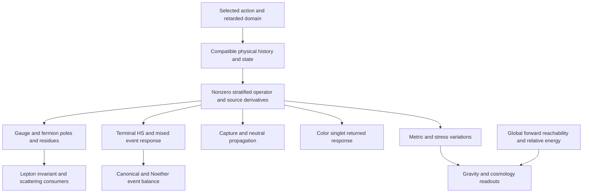

# BHSM whole system integration and remaining physical inputs

October 13, 2026

BHSM's strongest whole-system fit is that several particle, enclosure, event,
and cosmology calculations are compatible consumers of one action-owned
returned operator. They do not each need a new mechanism. The existing
architecture already preserves particle identity through reset and local
enclosure, transports finite-core response, and supplies the algebra for
returned-child balance. The integrations below complete additional consumer
interfaces; they leave the current physical completion status unchanged.

## The common dependency

The selected AE4 owner is

```text
Gamma_AE4 = -(1/2) STr E1(ell_star^2 P_strat)
P_strat = D_strat^dagger D_strat
```

with the relative zeta/eta prescription and BRST/zero-mode quotient. Its
M8/M5/M4 expansions share one functional and scale provenance. AE4 remains
successor work alongside the retained AE2 Gate-7 calculation. The
[owner contract](../theory/ae4_existing_asset_system_integration.md) does not
identify the retained geometry oracle with a complete interacting action.



These are dependencies. One common operator means common ownership and
compatible domains across the remaining physical evaluations.

## Existing sections that already fit

| Fit | Established scope | Remaining physical input |
| --- | --- | --- |
| Reset to local enclosure | The AE3 `sigma=0` carrier and separate tensor factors preserve all nine charged sector/family projectors | Full interacting traces and their compatible balance |
| Finite core to returned child | Factorized product-Dirac propagation transports the terminal Weyl load and HS jets | Action-owned terminal load and source derivatives over the required spectrum |
| Returned child to event balance | Same-action Schur elimination, response constraints, and canonical/Noether identities | Nonzero sector blocks and their physical normalization |
| Fermion poles to flavor readout | The charged-lepton logarithmic invariant cancels a common multiplicative scale | Compatible physical poles in independently selected family slots |
| Particle response to cosmology | The owner contract assigns metric/stress variations to the same functional | Evaluated stress/relative energy and global forward control |

The [enclosure transport](../theory/ae4_current_c2_physical_enclosure_state_integration.md)
is particularly useful: the canonical stop selects the future history
domain, while `sigma=0` selects the local material enclosure. Their distinct
roles prevent the stop from being mistaken for a spacetime edge. Existing
family identity can be inherited without reconstructing the spectrum.
The retained persistent nonequilibrium child is also reused; these consumer
interfaces do not require a new stationary soliton construction.

## Interfaces completed in this integration

[Mixed terminal HS transport](../src/bhsm/interface/ae4_mixed_terminal_hs.py)
composes two real source directions through the existing scalar HS coordinate
`H(u,v)` and terminal load `L(u,v)`. With saved partial derivatives
`a=M_H`, `b=M_HH`, `s=M_L`, `c=M_HL`, and `q=M_LL`, it retains

```text
M_uv = b H_u H_v + c(H_u L_v + H_v L_u) + q L_u L_v
       + a H_uv + s L_uv.
```

This reuses the fixed-core coefficients. Two independent bulk source
profiles, changed geometry, or a changed base load require their own
coefficients. Unknown terminal derivatives must be supplied explicitly.

[Mixed event response](../src/bhsm/interface/ae4_mixed_event_response.py)
retains the two-source chain rule through the noncommuting returned-child
Schur complement and moving KKT constraints. For `K y=f`,

```text
K y_uv = f_uv - K_uv y - K_u y_v - K_v y_u.
```

It also contracts every mixed trace/traction contribution to the existing
Noether flux for a fixed anti-Hermitian generator. This connects HS, source,
and constraint response to event balance without introducing a regulator or
selecting a physical terminal condition. Finite residuals do not certify
continuum response or the complete Hamiltonian readout.

[Charged-lepton pole readout](../src/bhsm/interface/charged_lepton_pole_observable.py)
connects admitted `DressedPole` outputs to

```text
R = 8 log(M_tau) - 9 log(M_mu) + log(M_e) - 54/pi.
```

It requires explicit family roles and common action, background, domain,
scale, and spectral conventions. Its Jacobian is `(8,-9,1)` in log-mass
coordinates; the coefficient sum vanishes. Full cross-family covariance
therefore propagates through the invariant, including correlated scale
cancellation. Mass-coordinate covariance uses the first-order delta method;
neither covariance convention is an outward numerical certificate. The
consumer supplies no self-energy or mode-selection rule.

## First missing common physical operand

The first shared value-level operand is the nonzero returned stratified
operator `D_strat_ret[Phi_star,Sigma_star]`, evaluated on a compatible
physical history/domain/state with its sector, contact, and mixed source
derivatives. The [full-field attachment audit](../theory/bhsm_current_full_field_action_attachment.md)
records why the 98-variable geometry oracle cannot supply independent
gauge/ghost, fermion, and HS blocks. The
[nonlinear carrier adjudication](../theory/ae4_current_c2_nonlinear_carrier_authority_adjudication.md)
also keeps affine jet candidates separate from nonlinear physical authority.

For the HS branch, the explicit missing leaves are `L_terminal(z)`,
`D_H L_terminal(z)`, and `D_H^2 L_terminal(z)`. The retained finite core
does not suppress their effect, so zero or reference terminal jets cannot
replace them. A negative-axis probe also cannot replace the full spectral
integration. For cosmology, local enclosure ownership does not supply global
forward reachability, `Q_xi`, or parent-relative `Delta H`.

The [five foundational junctions](../theory/bhsm_five_foundational_junctions_status.md)
remain the physical promotion tests: scale and dimensional provenance,
an action-owned background, normalized pole operators and stability, the full chiral
domain/index, and quantum/asymptotic state and amplitude construction.
Exactly one universal calibration may be used under the current
[Definition of Done](BHSM_1_0_DEFINITION_OF_DONE.md); sector retuning and
measured-data selection remain prohibited. These interfaces add no action
term, coefficient, particle assignment, empirical input, or completion claim.

## Reproducible integration checks

The [bridge materializer](../scripts/materialize_bhsm_whole_system_response_bridges.py)
reuses all four saved 1222-segment HS coefficient rows and exercises the mixed
event and Noether identities in the existing six-sector order. The event
matrices are explicit synthetic operands; a physical projection of the HS
reference rows into those matrices remains open. The
[integration artifact](../artifacts/action_extension/BHSM_WHOLE_SYSTEM_RESPONSE_BRIDGES_20261013.json)
retains the complete witness inputs and source hashes. Independent full-system
and transfer-matrix derivative tests, existing scalar-interface regression
checks, and covariance tests pass across 111 focused checks. The artifact
and a second materialization reproduce byte-for-byte.
The [verification receipt](../artifacts/action_extension/whole_system_bridges_20261013/verification.json)
pins the source hashes and reproduction pair; the
[audit results](../artifacts/action_extension/whole_system_bridges_20261013/audits.json)
record passing status, forbidden-claim, frozen-integrity, precision, and
public-readiness checks.
